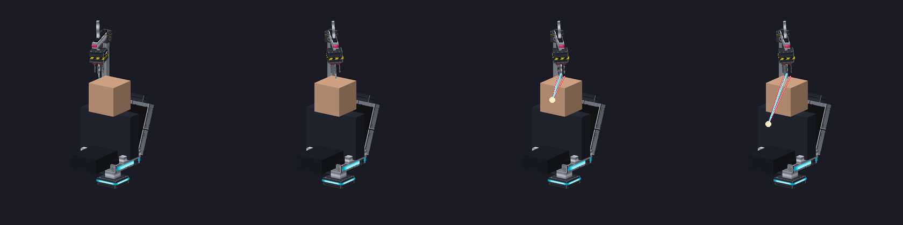
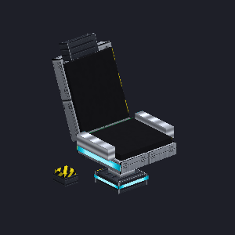
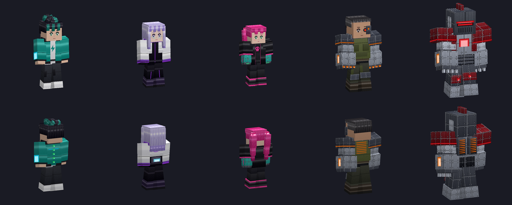
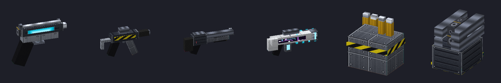
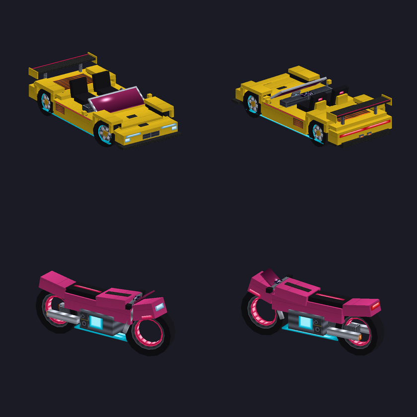
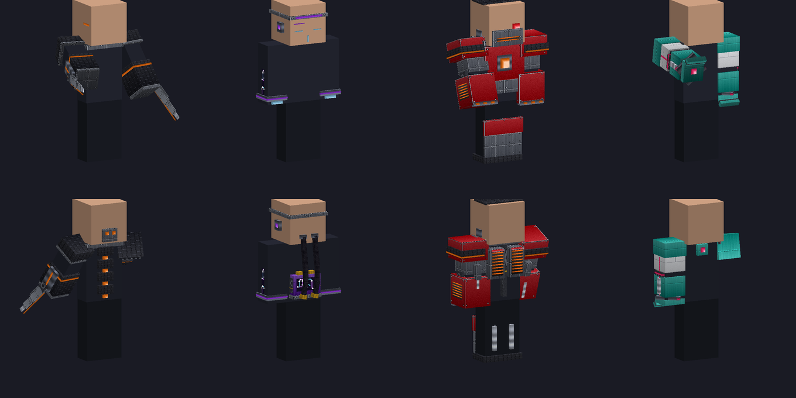
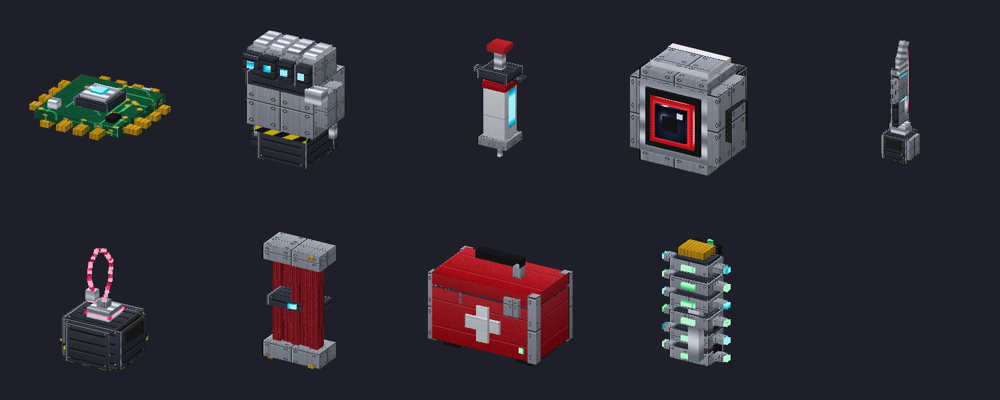

# Edgerunners: Cyberware

Фанатский мод для Minecraft 1.20.1 (Forge) по мотивам «Киберпанк: Бегущие по краю».
Неофициальный, не связан с CD PROJEKT RED и Studio Trigger.

## Установка
1. Скачайте [edgerunners-cyberware-1.20.1-1.7.0.jar](../../raw/edgerunners-mod/edgerunners-cyberware-1.20.1-1.7.0.jar).
2. Положите файл в `.minecraft/mods`.
3. Запустите Forge 1.20.1 (например, через TLauncher).

## Кресло риппердока
Импланты устанавливает только риппердок. Скрафтите **кресло риппердока**, поставьте его и нажмите ПКМ.
- Положите имплант в слот и нажмите «Установить». Шкала показывает, сколько психоза добавит операция.
- 4 слота тела: нейро-ОС (Сандевистан), оптика (Kiroshi), руки (руки гориллы **или** моноструна), ноги (сухожилия).
  В каждом слоте один имплант: чтобы сменить, сначала снимите старый.
- Кнопка «Снять» возвращает имплант в инвентарь.

**Операция.** После нажатия «Установить» персонаж садится в кресло (встать нельзя до конца), камера переходит
в кинематографичный вид спереди. Хирургическая рука поворачивается к пациенту, опускается над головой,
инструмент вращается, лазеры бьют в нужную часть тела (глаза, затылок, руки, колени или грудь — по слоту импланта),
летят искры. На экране — кардиограмма, этапы операции и прогресс, сердце бьётся всё чаще. В конце — вспышка,
рука уходит обратно. Установка ~7 секунд, извлечение ~4. Если операцию прервать (сломать кресло, выйти из игры),
имплант выпадет рядом с креслом.

Рецепт: `[чип][редстоун][ ]` / `[кожа][кожа][кожа]` / `[железо][ ][железо]`.

## Герои (чипы личности)
Оригинальные персонажи-архетипы по мотивам аниме (не копии его героев). ПКМ чипом — превратиться (ещё раз — вернуться).
Полная 3D-модель с аниме-лицом, анимированными волосами, одеждой и хромом; размер героя, бонусы и способность на **Z**.

| Герой | Пассивно | Способность [Z] |
|---|---|---|
| Беглый кид | +12% скорость, Сандевистан дольше | Рывок Сандевистана на 9 блоков |
| Нетраннерша | Моноструна +50%, перезарядка −30% | Квикхак «Перегрев» |
| Стрелок | Оружие +40%, перезарядка ×2 | Шквал: бесконечные патроны |
| Ветеран-борг | +6 брони, +3 сердца, удары руками | Удар о землю |
| Хромированный тиран | +12 брони, +8 сердец, медленнее | Ракетный залп |

## Оружие
Умный пистолет (самонаведение), пистолет-пулемёт (автомат), дробовик, тех-винтовка (пробивает насквозь).
ПКМ — огонь, Shift+ПКМ — перезарядка, нужны **патроны** (железо + порох + медь = 16).
Трассеры, вспышка у дула, отдача, счётчик патронов на экране.
**Ракетная установка** — имплант для рук: **G** — две самонаводящиеся микроракеты.

## Транспорт
- **Неоновый спидстер** — двухместный открытый суперкар: крутящиеся и поворачивающие колёса, антикрыло, подсветка днища, фары, стоп-сигналы.
- **Кибербайк** — светящиеся бесступичные колёса, поворачивающая вилка, наклон в поворотах.

Управление: **WASD** — езда, **Пробел** — ручник и дрифт (дым из-под колёс), **Ctrl** — нитро (пламя из выхлопа, шкала на HUD),
**H** — гудок, **Shift** — выйти, **Shift+ПКМ** — забрать в инвентарь. ПКМ красителем — перекрасить.
На скорости транспорт сбивает мобов. Спидометр, нитро и прочность корпуса — в правом нижнем углу.

Рецепты: спидстер — `[стекло][чип][стекло] / [жел. блок][блок редстоуна][жел. блок] / [угольный блок][жел. блок][угольный блок]`;
байк — `[ ][чип][железо] / [железо][блок редстоуна][железо] / [угольный блок][ ][угольный блок]`.

## Внешний хром
Четыре комплекта видимого хрома с анимациями (новый слот риппердока «Внешний хром», один комплект за раз):
- **Уличный самурай** — броня предплечий, выкидные лезвия раскрываются в бою и прячутся через несколько секунд. +2 к урону, быстрее атаки.
- **Нетраннер** — нейро-обруч, порты на висках, светящиеся линии на лице, кабели к кибердеке качаются при ходьбе. Способности перезаряжаются на 40% быстрее.
- **Тяжёлый борг** — красная броня, реактор на груди «дышит», заслонки на спине раскрываются при беге, поршни на руках ходят при ударе. +6 брони, устойчивость к отбрасыванию.
- **Наёмница** — полные кибер-руки, вращающийся ротор на запястье, пальцы сжимаются при ударе. +10% к скорости, +1 к урону, +2 сердца.

Хром виден и от первого лица. Модели описаны в `tools/gen_chrome.py`, превью — `tools/preview_chrome.py`.

## Эффекты атак
- **Сандевистан:** цветные остаточные изображения («призраки») за игроком, хроматическая аберрация на экране, вспышка-волна при запуске.
- **Моноструна:** светящаяся струна хлёстко проходит дугой, искры и брызги при попадании.
- **Клинок-богомол:** неоновые следы разреза, кровотечение у цели, дуга при рывке.
- **Руки гориллы:** ударная волна и тряска камеры.
- **Kiroshi:** волна сканирования на 40 блоков и линия скана на экране.
- **Двойной прыжок:** кольцо под ногами. **Киберпсихоз:** глитч-помехи, аберрация, тряска.

## 3D-модели
- Детальные модели с HD-текстурой материалов (сталь, хром, карбон, мышцы, линзы, неон) — в руке, на земле, в рамке и в инвентаре.
- Установленные импланты видны на персонаже: позвоночник Сандевистана на спине (мигает быстрее, когда активен),
  красные глаза Kiroshi, бронепластины рук гориллы, манжета моноструны, скобы сухожилий на коленях.

Модели и текстура материалов генерируются скриптами `tools/gen_models.py` и `tools/gen_materials.py`.

## Управление
- **V** — Сандевистан
- **R** — моноструна
- **B** — сканирование Kiroshi
- Прыжок в воздухе — двойной прыжок (усиленные сухожилия)

## Сборка из исходников
Нужна Java 17: `./gradlew build`, готовый файл появится в `build/libs`.
